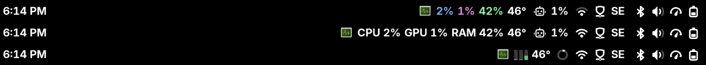
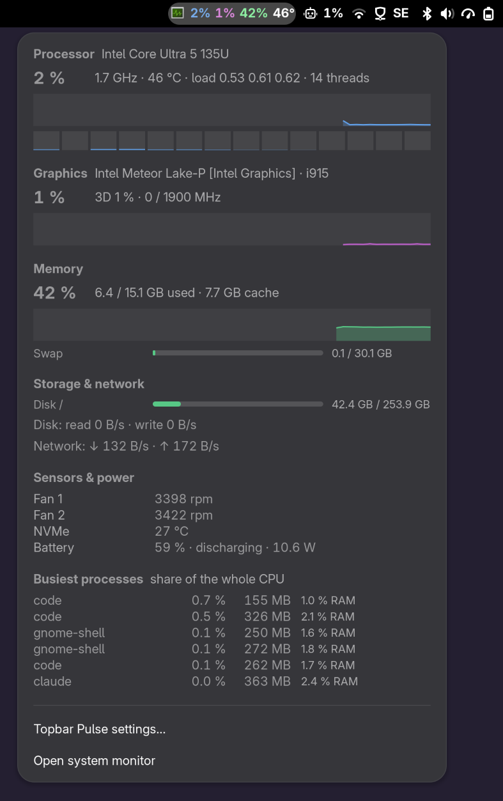
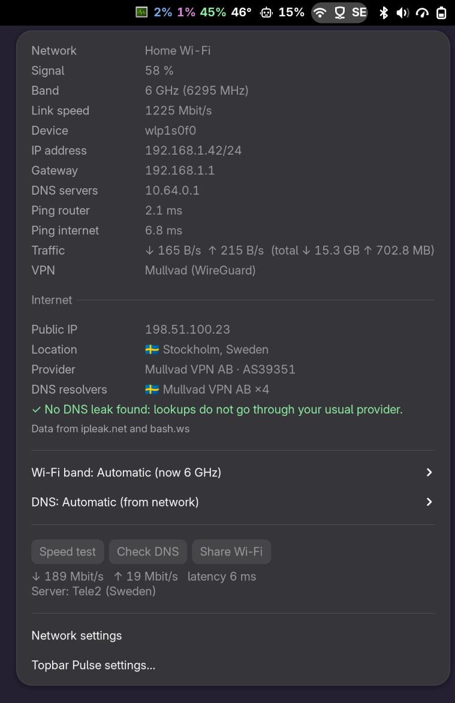
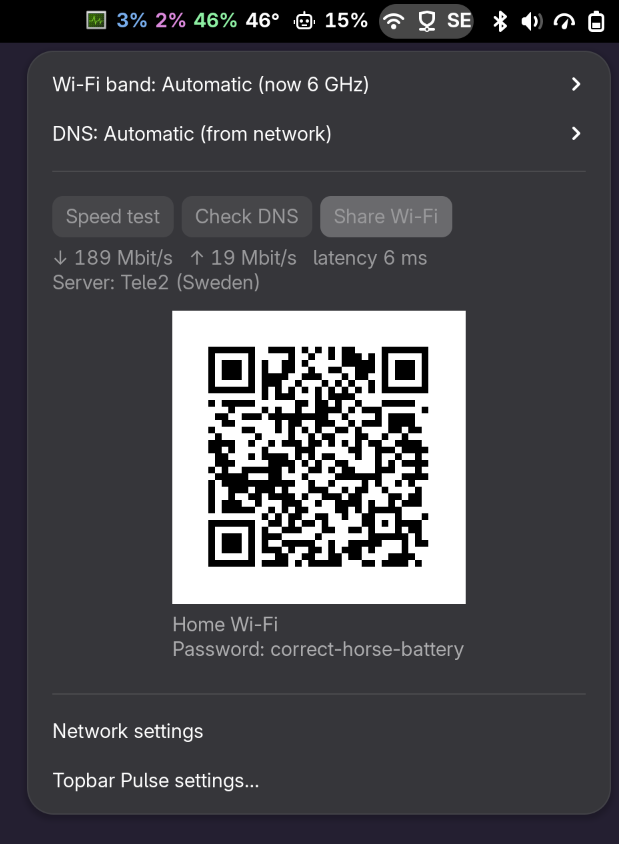
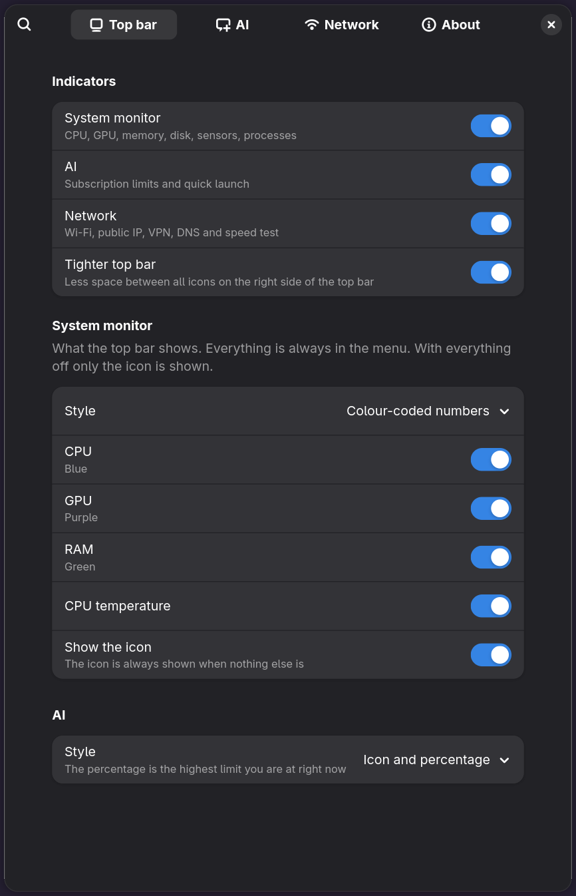

# Topbar Pulse

System monitor, network details and AI usage in the GNOME top bar.

Works on any GNOME 48–51 desktop. No other software is needed beyond what a
normal GNOME install already has (NetworkManager, libsoup, gjs).



| System monitor | AI | Network |
|---|---|---|
|  |  |  |

| Share Wi-Fi by QR code | Preferences |
|---|---|
|  |  |

<sub>Screenshots use example network data (documentation IP ranges, a demo Wi-Fi name and password); system and AI values are live. Regenerate with `tools/screenshots.sh`.</sub>

## What it shows

**System monitor** — CPU, GPU, RAM and temperature in the bar (as text,
colour-coded numbers or small bars, each optional). The menu has graphs of
the last two minutes, a bar per CPU thread, GPU load per engine (3D, video …),
memory and swap, disk usage and throughput, network throughput, fans,
battery power and the busiest processes.

- Intel and AMD GPU load is measured the way `intel_gpu_top` and `nvtop` do
  it (per-client engine time); NVIDIA through `nvidia-smi` when installed.

**Network** — Wi-Fi name, signal, band, link speed, addresses, gateway, DNS
servers, ping to router and internet, and live traffic. Plus:

- **Public IP and location** as the internet sees it, with provider — handy
  when switching between VPNs. Optionally the country code in the bar while a
  VPN is on.
- **DNS leak check**: which resolvers really answer for you, and a warning if
  lookups go through your usual provider while a VPN is active.
- **Wi-Fi band** (2.4 / 5 / 6 GHz or automatic) and **DNS provider**
  (automatic, Cloudflare, Google, Quad9, Mullvad or your own) per connection.
- **Speed test** (download from Tele2 or Hetzner, upload to Cloudflare).
- **Share Wi-Fi** as a QR code your phone can scan.
- Can hide GNOME's own network icon so there is only one.

**AI** — quick launch and subscription limits:

- Open Claude, ChatGPT, Gemini, GitHub Copilot, Microsoft Copilot, Grok,
  Le Chat, Perplexity, DeepSeek, Meta AI, Qwen, Kimi, Lumo, HuggingChat,
  OpenRouter — or add your own — as an **app window** (Chromium-based
  browsers) or a **browser tab**. Services with a CLI (`claude`, `codex`,
  `gemini`, `copilot` …) get a terminal button.
- **Limits** for Claude Code (session, week, model-specific), Codex/ChatGPT
  and GitHub Copilot premium requests, read with the sign-in those official
  CLIs already keep on the computer.
- **Today's Claude Code tokens**, split into new tokens and tokens re-read
  from the prompt cache (which otherwise make the totals look huge).

Everything can be switched on or off in the preferences.

## Privacy

Nothing is collected or sent to the author. The extension talks to:

| When | Service | What it learns |
|---|---|---|
| Public IP check (can be turned off) | ipleak.net | your public IP |
| DNS leak check (can be turned off) | bash.ws | your public IP and DNS resolvers |
| Speed test (only when you press it) | Tele2 / Hetzner, Cloudflare | your public IP |
| AI limits (can be turned off) | Anthropic, OpenAI (through the Codex CLI), GitHub | the same requests their own CLIs make |

## Install

From source:

```sh
git clone https://github.com/Lofblom/topbar-pulse
cd topbar-pulse
./build.sh install          # links src/ into ~/.local/share/gnome-shell/extensions
# log out and back in (Wayland), then
gnome-extensions enable topbar-pulse@lofblom.github.io
```

`./build.sh pack` makes the zip for extensions.gnome.org in `dist/`.

## Translations

English, Swedish, German, French and Spanish. To add a language, add a table
to `tools/translations.py` (or edit `po/<lang>.po` directly) and run:

```sh
./build.sh pot && python3 tools/make_po.py && ./build.sh
```

## Development

`tools/screenshots.sh` regenerates the README screenshots (demo network data).
`tools/test-nested.sh [out-dir] [language]` runs the extension in a nested
GNOME Shell (needs `mutter-devkit`) with throw-away settings, and saves
screenshots of the bar in every style and of every menu.
Set `TOPBAR_PULSE_DEBUG=1` to log what the indicators fetch.

## Credits

Inspired by the [Omarchy](https://omarchy.org) desktop. The AI usage
endpoints and their parsing follow Omarchy's agent usage collectors (MIT).
Service logos are trademarks of their owners and are only used to identify
the services.

## Licence

MIT — see [LICENSE](LICENSE).
