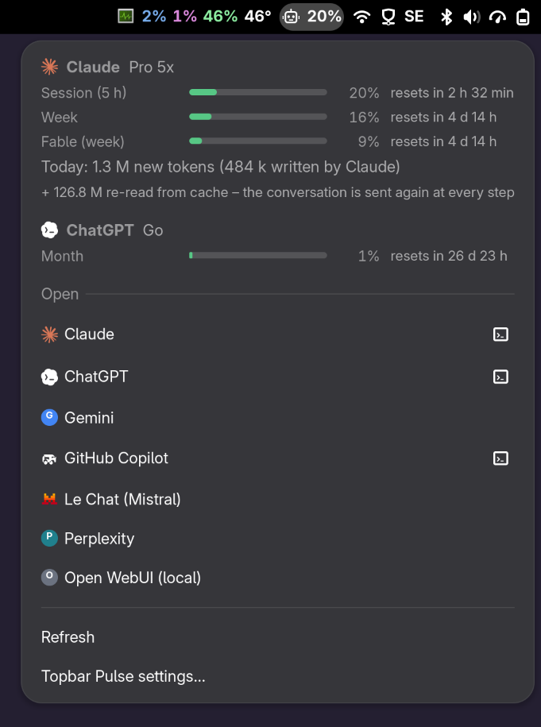

# Topbar Pulse

System monitor, network details and AI usage in the GNOME top bar.

Tested on GNOME 51. It will probably also work on GNOME 48–50 (it only uses
APIs that exist there), but that is not tested yet — reports are welcome.
No other software is needed beyond what a normal GNOME install already has
(NetworkManager, libsoup, gjs).


| System monitor | AI | Network |
|---|---|---|
|  |  |  |

| Share Wi-Fi by QR code | Preferences |
|---|---|
|  |  |

<sub>Screenshots use example network data (documentation IP ranges, a demo Wi-Fi name and password); system and AI values are live. Regenerate with `tools/screenshots.sh`.</sub>

**Privacy at a glance:** no telemetry, no account, nothing sent to the
author. Subscription limits are off until you turn them on; sign-ins are
never stored and only go to the provider's own HTTPS address. Details in
[Privacy and sign-ins](#privacy-and-sign-ins).

## What it shows

**System monitor** — CPU, GPU, RAM and temperature in the bar (as text,
colour-coded numbers or small bars, each optional). The menu has graphs of
the last two minutes, a bar per CPU thread, GPU load per engine (3D, video …),
memory and swap, disk usage and throughput, network throughput, fans,
battery power and the busiest processes.

- Intel and AMD GPU load is measured the way `intel_gpu_top` and `nvtop` do
  it (per-client engine time); NVIDIA through `nvidia-smi` when installed.

**Network** — Wi-Fi name, signal, band, link speed, addresses, gateway, DNS
servers, ping to router and internet, and live traffic. Plus:

- **Public IP and location** as the internet sees it, with provider — handy
  when switching between VPNs. Optionally the country code in the bar while a
  VPN is on.
- **DNS leak check**: which resolvers really answer for you, and a warning if
  lookups go through your usual provider while a VPN is active.
- **Wi-Fi band** (2.4 / 5 / 6 GHz or automatic) and **DNS provider**
  (automatic, Cloudflare, Google, Quad9, Mullvad or your own) per connection.
- **Speed test** (download from Tele2 or Hetzner, upload to Tele2 — public
  test servers made for this).
- **Share Wi-Fi** as a QR code your phone can scan.
- Can hide GNOME's own network icon so there is only one.

**USB** — a small icon that only appears while something is plugged in.
The menu names each device and its port; console cables (FTDI, Prolific,
CH340, CP210x, Cisco …) show their `/dev/ttyUSB…` path — click to copy it,
or open a serial console (`tio`, `picocom`, `minicom` or `screen`).

**AI** — quick launch and subscription limits:

- Open Claude, ChatGPT, Gemini, GitHub Copilot, Microsoft Copilot, Grok,
  Le Chat, Perplexity, DeepSeek, Meta AI, Qwen, Kimi, Lumo, HuggingChat,
  OpenRouter — or add your own, including a local server like Open WebUI —
  as an **app window** (Chromium-based browsers) or a **browser tab**.
  Services with a CLI (`claude`, `codex`, `gemini`, `copilot` …) get a
  terminal button.
- **Limits** (opt-in, one switch per service) for Claude Code (session,
  week, model-specific), Codex/ChatGPT and GitHub Copilot premium requests,
  read with the sign-in those official CLIs already keep on the computer.
- **Today's Claude Code tokens**, split into new tokens and tokens re-read
  from the prompt cache (which otherwise make the totals look huge).

Everything can be switched on or off in the preferences.

## Privacy and sign-ins

Nothing is collected or sent to the author. The extension talks to:

| When | Service | What it learns |
|---|---|---|
| Public IP check (on by default, can be turned off) | ipleak.net | your public IP |
| DNS leak check (same switch) | bash.ws | your public IP and DNS resolvers |
| Speed test (only when you press it) | Tele2 / Hetzner | your public IP |
| Claude limits (off until you turn it on) | api.anthropic.com | the same request Claude Code makes |
| Codex limits (off until you turn it on) | OpenAI, through the Codex CLI | the same request the Codex CLI makes |
| Copilot limits (off until you turn it on) | api.github.com | the same request the Copilot CLI makes |

**How sign-ins are handled.** The subscription limits use the sign-in the
official CLIs (Claude Code, Codex, GitHub CLI) already keep on your
computer. Topbar Pulse reads it only at the moment of a request and keeps it
in memory just for that request. It is never stored, cached, logged or shown,
and it is only sent as an `Authorization` header to the provider's fixed
HTTPS address — with certificate verification and with redirects disabled,
so it cannot be passed on to another host. For Codex the extension never
sees the sign-in at all: the Codex CLI's own app-server makes the request.

**Unofficial interfaces.** The Claude and Copilot usage endpoints are not
public APIs. They are what the official tools use themselves; they may
change or stop working without notice, and they are used at your own
discretion. That is why these readers are off by default.

**Check it yourself.** Like every GNOME Shell extension, Topbar Pulse runs
inside GNOME Shell with your user's rights. All code that touches sign-ins
is in two short files: [`src/lib/ai/usage.js`](src/lib/ai/usage.js) (which
file or command each reader uses and which host it asks) and
[`src/lib/http.js`](src/lib/http.js) (HTTPS only, no redirects).

## Install

From source:

```sh
git clone https://github.com/Lofblom/topbar-pulse
cd topbar-pulse
./build.sh install          # links src/ into ~/.local/share/gnome-shell/extensions
# log out and back in (Wayland), then
gnome-extensions enable topbar-pulse@lofblom.github.io
```

`./build.sh pack` makes the zip for extensions.gnome.org in `dist/`.

## Translations

English, Swedish, German, French and Spanish. To add a language, add a table
to `tools/translations.py` (or edit `po/<lang>.po` directly) and run:

```sh
./build.sh pot && python3 tools/make_po.py && ./build.sh
```

## Development

`tools/screenshots.sh` regenerates the README screenshots (demo network data).
`tools/test-nested.sh [out-dir] [language]` runs the extension in a nested
GNOME Shell (needs `mutter-devkit`) with throw-away settings, and saves
screenshots of the bar in every style and of every menu.
Set `TOPBAR_PULSE_DEBUG=1` to log what the indicators fetch.

## Credits

Inspired by the [Omarchy](https://omarchy.org) desktop. The AI usage
endpoints and their parsing follow Omarchy's agent usage collectors (MIT).
Service logos are trademarks of their owners and are only used to identify
the services.

## Licence

MIT — see [LICENSE](LICENSE).
